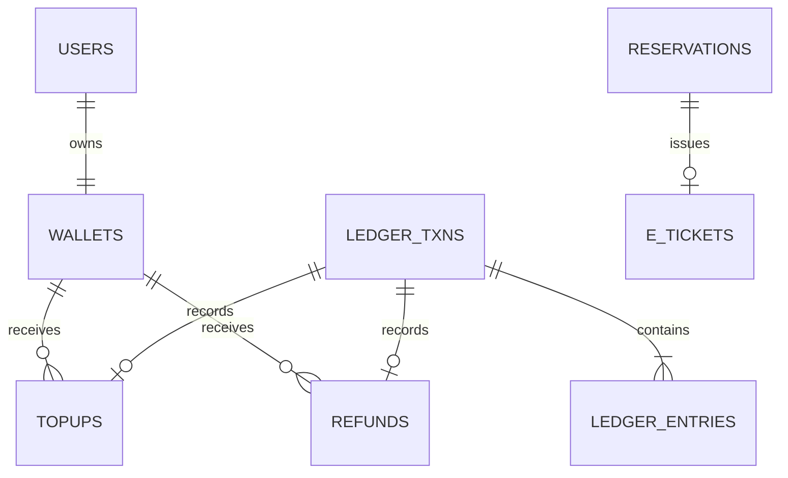

# G5 Wallet & Ticketing — database design

## Scope
This schema covers only G5's wallet, financial ledger, top-ups, refunds, and e-ticket metadata. G1 owns identity/accounts; G4 owns reservations and cancellations.

## Logical relationships

The diagram is a logical contract, not a guarantee that the upstream `users` and `reservations` table names/keys are already available. Confirm their exact definitions with G1 and G4 before applying the migrations.

## Table intent

| Table | Key constraints | Why it exists |
|---|---|---|
| `wallets` | One wallet per `user_id`; balance must be nonnegative | Current spendable balance |
| `ledger_txns` | Unique idempotency key and unique business reference | One logical financial event |
| `ledger_entries` | Positive amount; debit/credit side; transaction FK | Auditable double-entry accounting |
| `topups` | Unique idempotency key; positive amount | Records simulated wallet funding |
| `refunds` | Positive amount; unique business rule key | Refund history |
| `e_tickets` | Unique PNR and ticket number | Ticket metadata and QR payload |

## Double-entry convention

Amounts are always positive. The direction is stored in `entry_side` (`DEBIT` or `CREDIT`). For every posted logical transaction, total debits must equal total credits. The deferred constraint trigger validates the complete set at transaction commit, allowing the two sides to be inserted within one SQL transaction.

Example for a simulated top-up of ₹500:
- `RAILWAY_CLEARING` — DEBIT ₹500
- `CUSTOMER_WALLET` — CREDIT ₹500

Example for a wallet-funded ticket payment of ₹500:
- `CUSTOMER_WALLET` — DEBIT ₹500
- `RAILWAY_CLEARING` — CREDIT ₹500

The `wallets.balance` field is a cached current balance for fast reads. Every balance update must be performed in the same database transaction as the matching ledger entries.

## Concurrency and idempotency requirements

1. Lock a wallet row using `SELECT ... FOR UPDATE` before changing its balance.
2. Use the client-provided `Idempotency-Key` for top-up requests and enforce uniqueness in the database.
3. Perform balance check, balance update, ledger transaction, and ledger entries in one database transaction.
4. A retry with the same idempotency key must return the original result rather than apply the amount twice.
5. Do not treat HTTP 501 scaffold endpoints as implemented financial operations.

## Payments, refunds and tickets (migrations 0510-0517)

| Object | Purpose |
|---|---|
| `payments` | One wallet payment per PNR; links wallet and ledger transaction |
| `refund_rules` | Refund percent by hours before departure (48h: 90%, 12h: 75%, 4h: 50%, below: 0%); edit rows to change policy |
| `refund_amount(fare, hours_before, full)` | Applies the tier; `full` (railway cancelled the run) refunds 100% |
| `pay_reservation(user_id, pnr, idempotency_key)` (0513; 0517 sets the `YTR-<pnr>` ticket number) | Locks the wallet row `FOR UPDATE`, then the reservation; checks owner, status and balance; writes balanced ledger entries, updates the balance, records the payment, calls G4's `confirm_reservation(pnr)` and issues the e-ticket. A retry returns the original payment. Errors: `NR001` insufficient funds, `NR002` not found / not yours, `NR003` not payable |
| `fn_create_refund_on_cancellation()` | Trigger function for G4's `cancellations`: refund through a balanced ledger transaction, capped at the amount paid, idempotent per cancellation, nothing for unpaid holds |
| `attach_cancellation_refund_trigger()` | Attaches the trigger once `cancellations` exists (migration 0515 tries it; run it again after G4 merges if it returned false) |
| `v_wallet_statement` | Top-ups, payments and refunds with `SUM(...) OVER (PARTITION BY wallet_id ORDER BY posted_at, ledger_txn_id)` running balance |

### Contract assumed from other groups

Confirm these when G1 and G4 merge; column names live in `0513` and `0514` only.

* G1: `users(user_id)`.
* G4: `reservations(pnr TEXT, user_id, total_fare NUMERIC(10,2), status, departure_at)`; `confirm_reservation(pnr TEXT)` moves `PENDING_PAYMENT` to `CONFIRMED`; `cancellations(cancellation_id, pnr, fare_amount, cancelled_at, full_refund)` where `fare_amount` is the fare of the passengers cancelled and `full_refund` is true for a railway-cancelled run (G6).

`db/tests/support/g5_contract_stubs.sql` creates stand-ins for testing G5 alone. Do not apply it where the real G1/G4 tables exist.

### Tests

`db/tests/g5_wallet.sql` covers refund tiers and boundaries, payment, retry, insufficient funds, foreign and non-payable reservations, refund caps and the running balance. `backend/tests/test_wallet_payment_integration.py` includes four parallel payments of one PNR that charge once.

## Integration checklist
- [ ] Confirm G1 `users` primary key and RLS/session conventions.
- [ ] Confirm G4 PNR type, reservation table and `total_fare` type.
- [ ] Agree how G4 confirms a reservation after successful payment.
- [ ] Agree how G4 cancellation triggers a refund request.
- [ ] Add cross-module foreign keys in a new migration after the shared contracts are stable.
- [x] SQL tests for balanced ledger, insufficient funds, duplicate idempotency key and rollback (`db/tests/g5_wallet.sql`).
- [ ] Row-level security on wallets, payments, refunds and tickets once G1 provides `app.user_id`; until then the API filters by the authenticated user.
