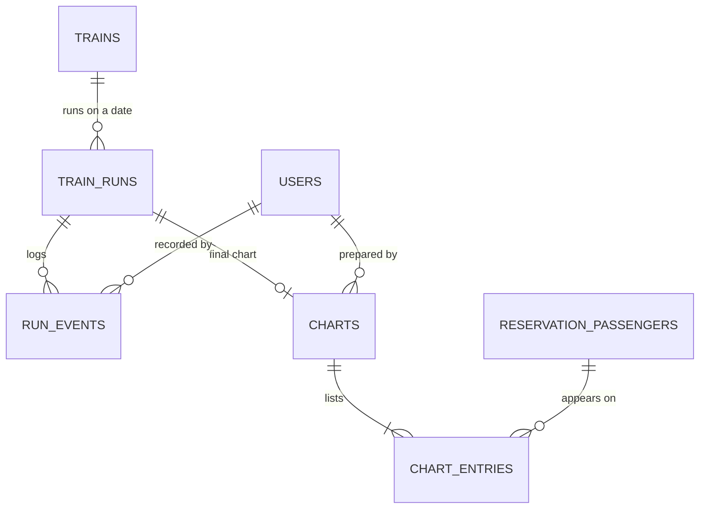

# G6 Operations & Analytics — database design

## Scope
G6 lets station staff run the railway (delays, cancelling a run, the final chart) and lets admins see how full and how profitable the trains are. This schema covers only G6's own tables, views, one function, one trigger and two materialized views. G1 owns users and roles, G2 the timetable, G3 coaches and berths, G4 reservations and cancellations, and G5 the wallet and refunds.

Owners: Member 1 frontend, Member 2 backend (`prepare_chart`, `mv_revenue`, the reports), Member 3 database (tables, `v_pnr_status`, the cancel trigger, `mv_occupancy`). Migration range `0600`–`0699`.

## Logical relationships

`reservations`, `reservation_passengers`, `berths`, `berth_allocations` and `cancellations` belong to other groups; G6 only reads them (and, in `prepare_chart`, moves waiting passengers onto free berths through the same tables G4 uses).

## Table intent

| Table | Key constraints | Why it exists |
|---|---|---|
| `train_runs` | `UNIQUE (train_id, run_date)`; status is one of `SCHEDULED`, `DELAYED`, `CANCELLED`, `DEPARTED`; `delay_minutes >= 0` | One row per train per date: its status, total delay and whether the chart is final |
| `run_events` | Index on `(run_id, recorded_at)`; `recorded_by` empty when a trigger wrote it | Log of what happened to a run (`DELAY`, `CANCEL`, `CHART`) |
| `charts` | `UNIQUE (run_id)` (one chart per run); `waiting_before`, `promoted` (migration 0619) | The final chart header, plus how many were waiting and how many got a berth |
| `chart_entries` | `UNIQUE (chart_id, passenger_id)` | One row per passenger on the chart, with coach, berth and quota |

## Objects, and the syllabus concept each shows

| Object | Migration | Concept |
|---|---|---|
| `v_pnr_status` | 0605 | Multi-table join view. Eight tables: `reservations`, `reservation_passengers`, `coaches` and `berths` (both `LEFT JOIN`), `trains`, `stations` twice (from and to), `train_runs` (`LEFT JOIN`, a run row may not exist yet). The plan names a six-table join; the extra joins add coach and berth type. |
| `trg_train_runs_cancel` / `fn_cancel_run_reservations()` | 0606 | `AFTER UPDATE OF status` trigger with a `WHEN` clause so it fires once. Cancels every live passenger through G4's `cancel_passenger(passenger_id, reason, full_refund)`; G5's trigger on `cancellations` then refunds 100%. Logs a `CANCEL` event. |
| `mv_occupancy` | 0607 | Materialized view (berths total / booked / percent per run and class) with a unique index so `REFRESH MATERIALIZED VIEW CONCURRENTLY` works. |
| `prepare_chart(run_id, user_id)` | 0620 | PL/pgSQL with an **explicit cursor**, row locking, a sub-transaction retry. Described below. |
| `mv_revenue` | 0621 | `GROUP BY GROUPING SETS ((day), (class), (day, class), ())` in one query, plus a unique index for `REFRESH ... CONCURRENTLY`. |

### `prepare_chart(run_id, user_id)`
1. `SELECT ... FOR UPDATE` on the `train_runs` row, so two staff members cannot prepare the same chart at once. Missing run raises `P0002`; a cancelled or departed run raises `55000`.
2. If `chart_prepared` is already true it returns the existing chart and changes nothing (safe to run twice).
3. An explicit cursor `c_waiting` walks every `RAC` then `WL` passenger of paid bookings on that run, in booking order (`ORDER BY` status rank, `reservations.created_at`, `passenger_id`), locking them with `FOR UPDATE OF rp`.
4. For each one it asks G3's `free_berths(train, date, from_seq, to_seq, class)` for berths free on that passenger's own stretch of the route, preferring their `berth_preference`, and inserts a `berth_allocations` row. If another booking took the berth a moment earlier, the exclusion constraint raises `exclusion_violation`; the function catches it in a sub-block and tries the next berth.
5. The passenger becomes `CNF` with coach, berth and no queue number.
6. It writes `charts` and one `chart_entries` row per remaining passenger (unpaid bookings are left out), counts berths nobody holds, sets `train_runs.chart_prepared = true` and logs a `CHART` run event.

Waiting passengers who still have no berth stay `RAC` / `WL`; refunding them is G4/G5's job, not G6's.

### `mv_revenue`
`grouping_level` comes from `GROUPING(day, class_code)`: `0` = day and class, `1` = day, `2` = class, `3` = grand total. "Day" is the **travel date**. Money counts bookings that are `CONFIRMED` / `PARTIALLY_CANCELLED`, or that were cancelled after being paid; `refunded` is the sum of completed refunds for them and `net = gross - refunded`. `day_key` and `class_key` are never null, only so a unique index can exist (required for `REFRESH ... CONCURRENTLY`).

## API contract

All routes are under `/api/v1`; errors are `{"detail": "...", "code": "..."}`. `/docs` is the live contract.

| Method and path | Who | What it does |
|---|---|---|
| `GET /pnr/{pnr}` | Public | Status of one booking from `v_pnr_status`; passenger names are masked (`P****** S*****`). `400 INVALID_PNR`, `404 PNR_NOT_FOUND` |
| `GET /ops/runs` | Staff | List runs; `run_date`, `page`, `page_size` (default 50, max 100) |
| `GET /ops/runs/{id}` | Staff | One run; `404 RUN_NOT_FOUND` |
| `POST /ops/runs/{id}/delay` | Staff | Set the total delay (`0` clears it), log a `DELAY` event |
| `POST /ops/runs/{id}/cancel` | Staff | Set the run `CANCELLED`; the trigger cancels and refunds everyone. `409 RUN_ALREADY_CANCELLED`, `409 RUN_NOT_ACTIVE` |
| `POST /ops/runs/{id}/chart` | Staff | Calls `prepare_chart`; returns promoted / remaining counts |
| `GET /ops/runs/{id}/chart` | Staff | The chart, coach by coach; `404 CHART_NOT_PREPARED` |
| `GET /reports/revenue` | Admin | From `mv_revenue`; `by=day\|class\|day_class\|total` |
| `GET /reports/occupancy` | Admin | From `mv_occupancy`; `by=class\|run` |
| `GET /reports/wl-conversion` | Admin | Of the passengers still waiting at chart time, the share who got a berth |
| `GET /reports/busiest-segments` | Admin | The stretches between two stops that carried most passengers |
| `POST /reports/refresh` | Job | Refresh `mv_occupancy` and `mv_revenue` concurrently |

Staff and admin checks are not enforced yet: they wait for G1's `require_role()` (marked `TODO(G1)` in the routers).

### Scheduled jobs (`backend/app/jobs/`)
`python -m app.jobs.run_operations` runs one pass; `--loop --every 15` repeats it. `prepare_due_charts` prepares the chart of every open run that is within 4 hours of its real departure (first stop's departure time plus delay, India time); one failing run never stops the others. `refresh_report_views` refreshes the two materialized views. Call it every 15 minutes from cron or Task Scheduler.

## Contract assumed from other groups

* G1: `users(user_id)`; later `require_role()` for the staff and admin routes.
* G2/G3: `trains`, `stations`, `train_stops(train_id, seq, station_id, departure)`, `coaches`, `berths`, `berth_allocations(berth_id, run_date, stops int4range, passenger_id, allocation_type)` with the exclusion constraint, and `free_berths(...)`.
* G4: `reservations`, `reservation_passengers` (`current_status` is `CNF`, `RAC`, `WL` or `CANCELLED`), `cancellations`, and `cancel_passenger(passenger_id, reason, full_refund DEFAULT false)`. **The third argument is G6's request:** with `true`, `cancellations.full_refund` is set and G5 refunds 100%.
* G5: the trigger on `cancellations` creates the refund; `refunds(pnr, amount, status)` feeds `mv_revenue`.

All of these are real now. The view, trigger and `prepare_chart()` use G4's column names (`reservation_id`, `train_no`, `passenger_name`, `coach_code`, `berth_number`).

## Load order on a fresh database
`python db/migrate.py up` (every group in order), `python db/import/load_sample.py`, `python db/import/generate_inventory.py`, then for a demo `db/seeds/g1_demo_users.sql` and `db/seeds/g6_demo_data.sql`. Seeds are for demos only; the SQL tests create their own data.

## Tests

| File | What it covers |
|---|---|
| `db/tests/g6_operations.sql` | Duplicate run rejected, bad status rejected, `v_pnr_status` rows and delay, cancelling a run refunds everyone (and cancelling twice does nothing), `mv_occupancy` unique key and percentage, and failure cases (unknown PNR, second chart for a run, missing run) |
| `db/tests/g6_prepare_chart.sql` | RAC before WL, oldest booking first, chart entries and berths, `waiting_before` / `promoted`, run locked and `CHART` event, safe to run twice, unpaid bookings left off, cancelled and missing runs refused |
| `backend/tests/operations/` | 42 API and job tests (fake connection, no database needed) |

Run the database tests with `psql "$DATABASE_URL" -v ON_ERROR_STOP=1 -f db/tests/<file>.sql`; they roll back and leave the data as it was.

## Viva demonstration

1. Cancel a run in `/docs` (`POST /ops/runs/1/cancel`), then show `GET /pnr/1000000000`: every passenger is `CANCELLED`, the wallet is refunded, and `run_events` has a `CANCEL` row. One `UPDATE` did all of it: that is the trigger.
2. Run `db/tests/g6_prepare_chart.sql`: free two berths on a full coach, call `prepare_chart`, and watch the RAC passenger get a berth before the first waiting-list passenger.
3. Explain the cursor: why `FOR UPDATE OF rp` (no one else may change those passengers meanwhile), why the order is RAC then WL then booking time, and why the `exclusion_violation` handler is needed (a booking can take a berth between looking and writing).
4. Show `mv_revenue` with `GROUPING SETS`: one query gives daily, per-class, per-day-and-class and grand-total rows; then `REFRESH MATERIALIZED VIEW CONCURRENTLY mv_revenue` and why the unique index is required.

## Integration checklist
- [x] SQL tests for the cancel trigger and `prepare_chart` (`db/tests/g6_operations.sql`, `db/tests/g6_prepare_chart.sql`).
- [x] API tests for every G6 route and both jobs.
- [x] G4 provides `cancel_passenger(passenger_id, reason, full_refund)` with real RAC/WL promotion (`0408`); the stand-in is gone.
- [x] `require_role()` guards the routers: `/ops` needs staff or admin, `/reports` needs admin.
- [x] `refresh_mv_occupancy()` / `refresh_mv_revenue()` (`0623`) let the restricted API role refresh the views it does not own.
- [x] `python -m app.jobs.run_operations --loop` runs in the `worker` service of `docker-compose.yml`.
- [ ] A merged migration is never edited: any change to `0619`–`0621` after the merge into `main` goes in a new file (`0622` onward).
